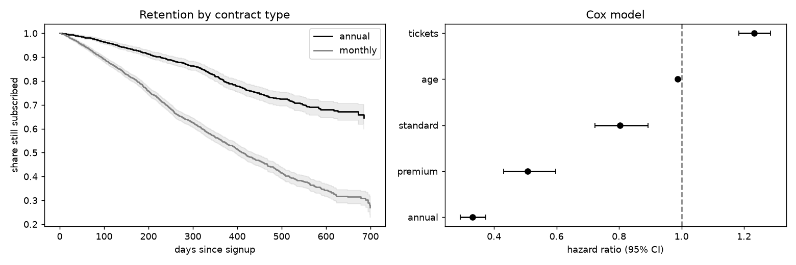

# survival-analysis-churn

Survival analysis of customer churn with censoring: Kaplan-Meier, log-rank test, Cox proportional hazards.

## Task

Estimate how long customers stay when many of them are still active at the end of observation, and which factors speed up churn.

## Approach

- Churn times follow a Weibull distribution with a hazard that depends on plan, contract, support tickets and age; customers still active at the end are right-censored.
- `kaplan_meier` is implemented from scratch with Greenwood intervals; `logrank_test` compares two groups; `cox_model` uses statsmodels `PHReg`.
- Tests check the estimator on tiny hand-computed examples, including censoring.

## Results



- 5,000 customers, 67% censored.
- Retention after 365 days: 64% overall; annual contracts 81% against 55% for monthly.
- Log-rank test for contract type: p = 5.39e-69.
- Cox hazard ratios: premium 0.51, standard 0.8, annual 0.33, tickets 1.23, age 0.99.

## Run

```bash
pip install -r requirements.txt
python run.py      # generates data, runs the analysis, writes reports/
pytest             # unit tests
```

## Layout

```
src/data.py     data generation (fixed seed, no downloads)
src/core.py     analysis / model code
run.py          end-to-end script
tests/          unit tests
reports/        figures and summary.json produced by run.py
```

## Notes

The data is generated by `src/data.py` with a fixed random seed, so the numbers above are reproducible. It is synthetic: it is meant to show the method, and results on real data will differ.

Stack: pandas, scipy, statsmodels, matplotlib.
